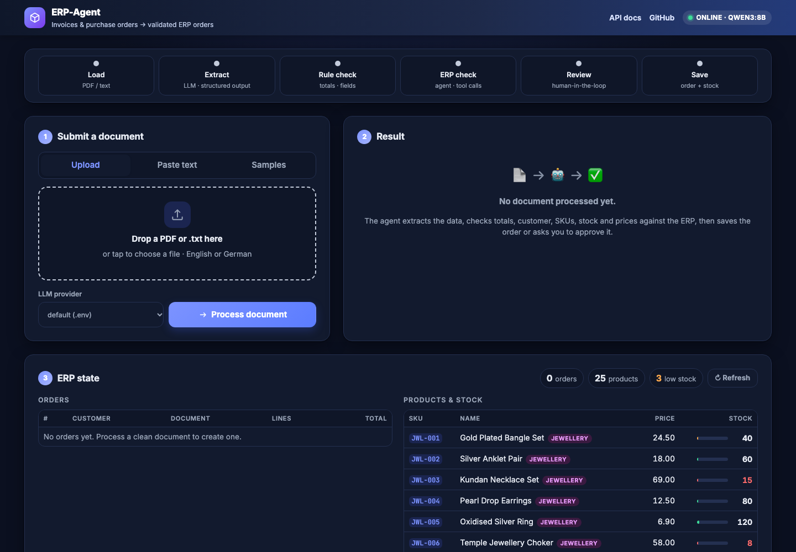
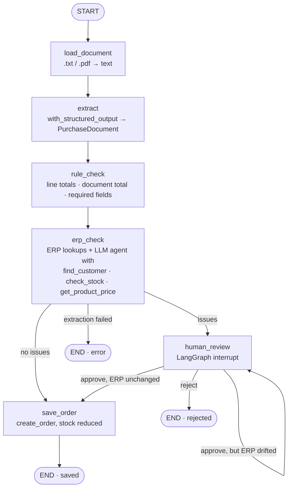
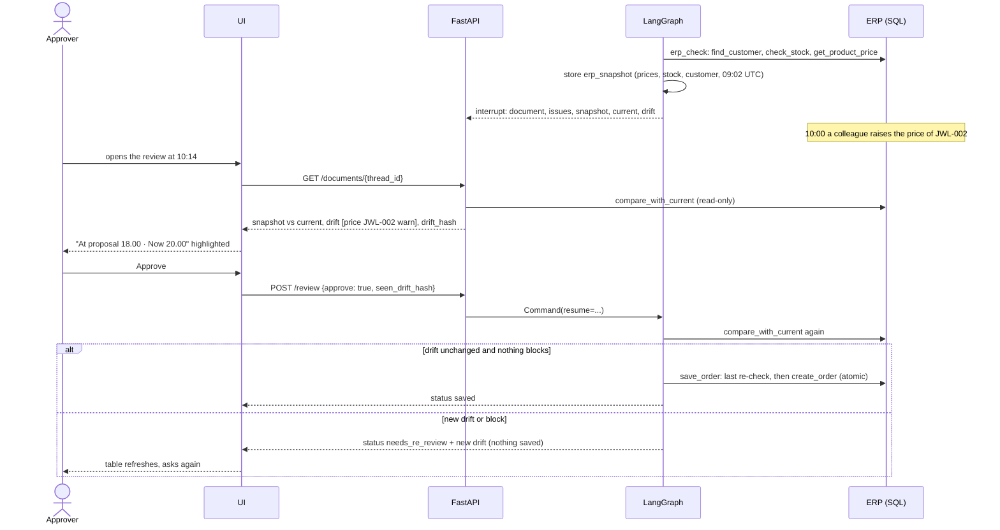

# ERP-Agent

**A LangGraph agent that reads invoices and purchase orders, validates them against an ERP, and only saves orders a human would sign off on.**


[](https://github.com/lakkadumang06/ERP_Agent/actions/workflows/ci.yml)

[](https://erp-agent-u7bv.onrender.com/)

**Live demo:** [erp-agent-u7bv.onrender.com](https://erp-agent-u7bv.onrender.com/) · [API docs](https://erp-agent-u7bv.onrender.com/docs). Free tier: the first request after idle time takes about 40 seconds to wake the service.

## Demo



A clean purchase order goes straight into the ERP:

```text
$ python scripts/run_cli.py data/sample_docs/po_001.txt
Provider: openai (gpt-6.1-sol)

Purchase Order PO-2026-0113 from Shree Ganesh Jewels
  JWL-001     10 x    24.50 =    245.00  Gold Plated Bangle Set
  JWL-004     20 x    12.50 =    250.00  Pearl Drop Earrings
  JWL-008     15 x    14.00 =    210.00  Meenakari Jhumka
  total: stated 705.00 EUR, computed 705.00

Log:
  load_document: data/sample_docs/po_001.txt (790 chars)
  extract: purchase_order PO-2026-0113, 3 lines
  rule_check: 0 issue(s)
  erp_check: agent ran (customer, stock and prices verified); 0 issue(s) total
  save_order: created order 1

Status: saved (order id 1)
```

A document with an error stops and asks a human:

```text
$ python scripts/run_cli.py data/sample_docs/err_over_stock.txt --provider anthropic
Provider: anthropic (claude-sonnet-5-5)

Purchase Order PO-2026-0919 from Saurashtra Silver Works
  JWL-006     25 x    58.00 =   1450.00  Temple Jewellery Choker
  JWL-005     40 x     6.90 =    276.00  Oxidised Silver Ring
  total: stated 1726.00 EUR, computed 1726.00

Issues:
  - [error] insufficient_stock: Line 1: only 8 units of JWL-006 in stock, 25 requested.

Log:
  load_document: data/sample_docs/err_over_stock.txt (612 chars)
  extract: purchase_order PO-2026-0919, 2 lines
  rule_check: 0 issue(s)
  erp_check: agent ran (stock shortfall on JWL-006 confirmed); 1 issue(s) total

Approve? [y/N] n

After review:
  human_review: rejected

Status: rejected
```

## Web UI

The API serves a small single-page UI at `http://localhost:8000/` (plain HTML/CSS/JS in `app/static`, no build step). Drop a PDF or text file, paste text, or pick one of the bundled sample documents; the page shows the extracted lines, the validation issues, an **Approve / Reject** panel when the graph pauses for review, and the live orders and stock tables from the ERP.


## Why I built this

I am a Business Information Systems student, and before that I built ERP systems for manufacturing and FMCG clients. In every one of those projects somebody still typed incoming purchase orders and supplier invoices into the system by hand, and every typo became a wrong delivery, a wrong price or an angry phone call. Large language models can now read those documents, but no client would let a model write straight into the order book. ERP-Agent is my answer to that: structured extraction, exact checks against the ERP, an agent that double-checks with tools, and a human approval step for anything that looks off.

## Architecture



Every run is checkpointed by `thread_id` with `MemorySaver`, so a run paused at `human_review` is resumed later with `Command(resume={"approve": true})`, from the CLI or through `POST /documents/{thread_id}/review`. More detail in [docs/architecture.md](docs/architecture.md).

## Features

| Feature | Concept it demonstrates | Where |
|---|---|---|
| One `get_llm()` for OpenAI, Anthropic, Groq, Gemini and OpenRouter, switched by `LLM_PROVIDER` or per request | Model-agnostic LLM layer | `app/llm.py` |
| `PurchaseDocument` extracted with `with_structured_output(method="json_schema")`, one retry on schema error | Structured outputs | `app/extract.py`, `app/schemas.py` |
| Agent bound to three read-only `@tool`s, hand-written loop with max 8 iterations, structured verdict | Tool calling | `app/tools.py`, `app/graph.py` |
| `interrupt()` with the document and issues, resume with `Command` | Human-in-the-loop | `app/graph.py` |
| Snapshot at proposal time, "then vs now" at review time, approval only against the version the human saw | Stale-proposal protection | `app/recheck.py`, `app/graph.py` |
| `MemorySaver` keyed by `thread_id`, one graph instance behind the API | Checkpointing | `app/api.py` |
| Runs tagged `provider:<name>` with model metadata | LangSmith tracing | `app/graph.py` |
| Field / line accuracy, issue detection, false alarms, latency, cost per provider | Evals | `evals/run_evals.py` |
| Deterministic checks and atomic `create_order` the model can never call | Safety by design | `app/validate.py`, `app/tools.py` |

Also: PDF and text input in English and German (Rechnung, Bestellung, Menge, Lieferschein), FastAPI with Swagger docs, Docker image, optional MCP server, and a test-suite that runs without API keys.

## Quickstart

macOS / Linux:

```bash
git clone https://github.com/lakkadumang06/ERP_Agent.git && cd ERP_Agent
python3 -m venv .venv && source .venv/bin/activate
pip install -r requirements.txt
cp .env.example .env                 # add OPENAI_API_KEY and/or ANTHROPIC_API_KEY
python -m app.seed                   # creates data/erp.db: 10 customers, 25 products
python scripts/run_cli.py data/sample_docs/po_001.txt
uvicorn app.api:app --reload         # http://localhost:8000/docs
docker compose up --build            # same API in a container
```

Windows PowerShell:

```powershell
git clone https://github.com/lakkadumang06/ERP_Agent.git; cd ERP_Agent
python -m venv .venv; .\.venv\Scripts\Activate.ps1
pip install -r requirements.txt
Copy-Item .env.example .env          # add OPENAI_API_KEY and/or ANTHROPIC_API_KEY
python -m app.seed
python scripts/run_cli.py data/sample_docs/po_001.txt
uvicorn app.api:app --reload
docker compose up --build
```

`make setup`, `make seed`, `make run`, `make cli DOC=...`, `make test`, `make eval` and `make lint` wrap the same commands.

No paid key? See [Free models for testing](#free-models-for-testing).

## Start the project (day-to-day)

Once installed, this is all you need each time (one terminal).

**macOS / Linux**

```bash
cd ERP_Agent
source .venv/bin/activate    # prompt now starts with (.venv)
python -m app.seed           # optional: reset the demo database
make run                     # http://localhost:8000/
```

**Windows PowerShell**

```powershell
cd ERP_Agent
.\.venv\Scripts\Activate.ps1
python -m app.seed
uvicorn app.api:app --reload --port 8000
```

Then open:

| What | URL |
|---|---|
| Web UI | http://localhost:8000/ |
| Swagger API docs | http://localhost:8000/docs |
| Health (active model) | http://localhost:8000/health |

Stop with Ctrl+C. Common problems:

| Symptom | Fix |
|---|---|
| `command not found: python` / `uvicorn` | The venv is not active: run `source .venv/bin/activate` (macOS/Linux) or `.\.venv\Scripts\Activate.ps1` (Windows). Do not mix the two systems' commands. |
| `address already in use` on port 8000 | An old server is running: `lsof -ti :8000 \| xargs kill` (macOS/Linux) or close that terminal, then `make run` again. |
| UI pill says `API offline` | Terminal 2 is not running; read its output. |
| Result shows `..._API_KEY is not set` | Add that provider's key to `.env` and restart, or pick another provider in the dropdown. |

## API examples

Clean document, saved immediately:

```bash
curl -s -X POST http://localhost:8000/documents -F "file=@data/sample_docs/po_001.txt"
```

```json
{
  "status": "saved",
  "order_id": 1,
  "thread_id": "5f1c0f8e-2d4b-4b1e-9a2d-7c0c9d7e1a11",
  "document": {
    "doc_type": "purchase_order",
    "document_number": "PO-2026-0113",
    "document_date": "2026-01-13",
    "customer_name": "Shree Ganesh Jewels",
    "currency": "EUR",
    "lines": [
      {"sku": "JWL-001", "description": "Gold Plated Bangle Set", "quantity": 10, "unit_price": 24.5, "line_total": 245.0},
      {"sku": "JWL-004", "description": "Pearl Drop Earrings", "quantity": 20, "unit_price": 12.5, "line_total": 250.0},
      {"sku": "JWL-008", "description": "Meenakari Jhumka", "quantity": 15, "unit_price": 14.0, "line_total": 210.0}
    ],
    "stated_total": 705.0
  },
  "issues": []
}
```

Document with a wrong total, routed to a human (JSON body, provider override):

```bash
curl -s -X POST http://localhost:8000/documents -H "Content-Type: application/json" \
  -d '{"text": "PURCHASE ORDER PO-2026-0705 ... Gesamtsumme (EUR): 487.00", "provider": "anthropic"}'
```

```json
{
  "status": "needs_review",
  "order_id": null,
  "thread_id": "0b7c5a7e-8e1f-4e1d-a3a2-1f6d2b7c9e55",
  "document": { "document_number": "PO-2026-0705", "customer_name": "Nordlicht Schmuck", "stated_total": 487.0, "...": "..." },
  "issues": [
    {"code": "document_total_mismatch", "message": "Stated total 487.00 does not match the sum of lines 387.00.", "severity": "error"}
  ]
}
```

Before deciding, the approver fetches the current view. The ERP is re-read now, and `recheck` shows the values at proposal time, the values now and the drift between them:

```bash
curl -s http://localhost:8000/documents/0b7c5a7e-8e1f-4e1d-a3a2-1f6d2b7c9e55
```

```json
{
  "status": "needs_review",
  "recheck": {
    "snapshot_at": "2026-11-10T09:02:11+00:00",
    "checked_at": "2026-11-10T10:14:38+00:00",
    "snapshot": {"customer": {"found": true, "id": 7, "name": "Nordlicht Schmuck"}, "lines": [{"sku": "JWL-002", "found": true, "unit_price_catalogue": 18.0, "stock": 60}, {"sku": "JWL-005", "found": true, "unit_price_catalogue": 6.9, "stock": 120}]},
    "current":  {"customer": {"found": true, "id": 7, "name": "Nordlicht Schmuck"}, "lines": [{"sku": "JWL-002", "found": true, "unit_price_catalogue": 20.0, "stock": 60}, {"sku": "JWL-005", "found": true, "unit_price_catalogue": 6.9, "stock": 120}]},
    "drift": [{"field": "price", "sku": "JWL-002", "value_at_proposal": 18.0, "value_now": 20.0, "severity": "warn", "message": "Catalogue price of JWL-002 changed from 18.00 to 20.00."}],
    "drift_hash": "3f9c1b2a7d4e5f60",
    "blocked": false
  },
  "...": "..."
}
```

Human decision, approving against the version actually seen:

```bash
curl -s -X POST http://localhost:8000/documents/0b7c5a7e-8e1f-4e1d-a3a2-1f6d2b7c9e55/review \
  -H "Content-Type: application/json" -d '{"approve": true, "seen_drift_hash": "3f9c1b2a7d4e5f60"}'
# → {"status": "saved", "order_id": 2, ...}
# If the ERP changed again in between: {"status": "needs_re_review", "recheck": {...new drift...}}
```

Other endpoints: `GET /health`, `GET /providers` (configured LLM providers), `GET /orders` (orders with lines), `GET /products` (catalogue with stock). Interactive docs at `/docs`.

## Approval re-check: why the approver sees "then vs now"

Human approval has its own timing gap. An order can wait in the review queue for an hour, and by then a price or a stock level may have changed. The approver would then sign off on data that was only correct when the proposal was drafted. Stock was already safe (`create_order` re-checks it inside the transaction), but price and customer data were not, and the review screen showed a snapshot from extraction time without saying so.

Since v1.1 the graph closes that gap with deterministic code only (no LLM involved):

1. **Snapshot at proposal time.** `erp_check` stores the catalogue price and stock of every SKU, the matched customer and a UTC timestamp in the graph state.
2. **Fresh view at review time.** `compare_with_current()` in `app/recheck.py` re-reads the ERP through the same read-only tools and lists every difference as a drift item. `block`: stock is now below the quantity, the customer is missing, a SKU vanished. `warn`: the catalogue price moved by more than `RECHECK_PRICE_TOLERANCE` (default 0.5 %), or stock dropped but still covers the order.
3. **Both shown side by side.** The review screen renders "At proposal" vs "Now" with changed cells highlighted and a banner when there is drift. `GET /documents/{thread_id}` returns the same data.
4. **Approve against a version.** The approval carries the `drift_hash` of the view the human looked at. The graph compares again at approval time: new drift the approver did not see returns `needs_re_review` and asks again; blocking drift is never saved.
5. **Save guard.** `save_order` compares one last time right before `create_order`. The stock check inside the transaction stays the final guard.



Try it: process `err_wrong_total.txt`, then change a price in the database while the order waits, for example with `sqlite3 data/erp.db "UPDATE products SET unit_price = 20 WHERE sku = 'JWL-002'"`, and click **Re-check now** or **Approve**.

Inspired by a discussion on LinkedIn about the timing gap in human approval.

## Switching providers

```bash
LLM_PROVIDER=anthropic        # openai | anthropic | groq | gemini | openrouter
```

Model names are configurable per provider (`OPENAI_MODEL`, `ANTHROPIC_MODEL`, `GROQ_MODEL`, ...), and the provider can be overridden per request (UI dropdown or `"provider"` field) or per CLI run (`--provider`). Only `app/llm.py` imports vendor SDKs: `ChatOpenAI` (OpenAI, Groq, OpenRouter), `ChatAnthropic` and `ChatGoogleGenerativeAI` (Gemini needs its native API because Gemini 3 requires "thought signatures" on replayed tool calls, which the OpenAI-compatible endpoint drops).

### Free models for testing

No paid key is needed. Every provider below is a named preset; put its key in `.env`, and it appears in the UI dropdown (and `GET /providers`). Several can be configured at once and switched per request.

| Provider | `.env` key | Default model | Get a key |
|---|---|---|---|
| **Groq** (free tier, fastest) | `GROQ_API_KEY` | `openai/gpt-oss-120b` | console.groq.com |
| **Google Gemini** | `GEMINI_API_KEY` | `gemini-3.5-flash` (Pro models are paid-only on the API) | aistudio.google.com |
| **OpenRouter** (free models) | `OPENROUTER_API_KEY` | `nvidia/nemotron-3.5-super-vl:free` | openrouter.ai/keys |
| OpenAI (paid) | `OPENAI_API_KEY` | `gpt-6.1-sol` | platform.openai.com |
| Anthropic (paid) | `ANTHROPIC_API_KEY` | `claude-sonnet-5-5` | console.anthropic.com |

Set the default with `LLM_PROVIDER=groq` (or any name above); override per request with the UI dropdown, the `provider` field of the API, or `--provider` on the CLI. Model names are configurable (`GROQ_MODEL`, `GEMINI_MODEL`, ...). Groq and OpenRouter speak the OpenAI protocol and share one code path; Gemini uses its native SDK. Free-tier limits and free model lists change often (OpenRouter rotates its `:free` models), so check the provider page if a model returns 404 or 429.

### LangSmith tracing

```bash
LANGSMITH_TRACING=true
LANGSMITH_API_KEY=lsv2_...
LANGSMITH_PROJECT=erp-agent
```

Nothing else changes. Every run is tagged `erp-agent` and `provider:<name>` and carries `{provider, model}` metadata, so the two providers can be filtered and compared side by side in the LangSmith UI.

## Evaluation results

`make eval` (or `python -m evals.run_evals --providers openai anthropic`) runs the full graph on the 10 documents in `evals/dataset.json` for every provider that has an API key, against a fresh seeded database, and writes `evals/results.md`:

<!-- BEGIN evals/results.md -->
| Provider | Model | Field accuracy | Line accuracy | Issue detection | False alarms | Avg latency | Tokens | Total cost (approx.) |
|---|---|---|---|---|---|---|---|---|
| openai | `gpt-6.1-sol` | – | – | –/4 | –/6 | – | – | – |
| anthropic | `claude-sonnet-5-5` | – | – | –/4 | –/6 | – | – | – |
<!-- END evals/results.md -->

- **Field accuracy**: customer name, document number and stated total.
- **Line accuracy**: lines where SKU, quantity and unit price are all correct.
- **Issue detection**: the 4 error documents flagged with the expected issue code (`document_total_mismatch`, `unknown_sku`, `insufficient_stock`, `unknown_customer`).
- **False alarms**: clean documents sent to review (lower is better).
- **Cost** is estimated from token usage and the `PRICES` table in `app/llm.py`; it is approximate by design.

Paste the table from `evals/results.md` between the markers above after running the evals.

## Design decisions and trade-offs

**Why LangGraph instead of a plain chain?** The workflow branches (save or review), can pause for hours (human approval) and must be resumable. LangGraph gives explicit nodes and edges, a checkpointer keyed by `thread_id` and `interrupt()` for the pause, and each node shows up as a readable step in a LangSmith trace.

**Why deterministic checks before the LLM?** Arithmetic and database lookups are cheap, exact and unit-tested, so they are the safety net: a wrong total or an unknown SKU is caught even when the model has a bad day. The agent adds judgement the rules cannot encode, such as a description that does not fit the SKU, and its findings are merged with, never replace, the deterministic ones. If the agent fails, the run is flagged for review rather than passing silently.

**Why the LLM never calls `create_order`?** Writing into an order book is irreversible in practice. The model only gets the three read-only tools; the single write happens in the `save_order` node after validation and, if needed, human approval. `create_order` is atomic, so even an approved order with an unknown SKU or insufficient stock is refused.

**Why a hosted model instead of a local one?** I started with a local model through Ollama, because it is free and keeps documents on my own machine. On my laptop, though, one document took far too long: extraction plus the agent's tool-calling loop made several model calls, and each one was slow on local hardware. For a review workflow that a user waits on, that was not usable, so I switched to Gemini via its API for fast responses, and kept the model-agnostic `get_llm()` layer so the provider is one setting. A local model remains a valid option where data must not leave the company; it would need a GPU server instead of a laptop.

**Why `json_schema` structured output?** Both vendors offer native constrained decoding. It is more reliable than prompting for JSON and avoids forced tool calls, which the current Anthropic models reject. The Pydantic field descriptions double as extraction instructions.

**Limitations.** `MemorySaver` forgets paused runs on restart; use a SQLite or Postgres checkpointer in production. PDF reading is text-based, so scanned documents need OCR first. Customer matching is `difflib` fuzzy matching, fine for a demo but a real system would use master-data services. One currency (EUR) throughout.

## Project structure

```text
erp-agent/
├── app/
│   ├── config.py        # pydantic-settings: LLM_PROVIDER, models, DATABASE_URL, LangSmith
│   ├── llm.py           # get_llm(), PRICES, estimate_cost()  (only vendor imports)
│   ├── schemas.py       # OrderLine, PurchaseDocument, Issue, ValidationResult, ProcessResult
│   ├── db.py            # SQLAlchemy models + get_session()
│   ├── seed.py          # python -m app.seed  (10 customers, 25 products)
│   ├── tools.py         # @tool find_customer, check_stock, get_product_price, create_order
│   ├── extract.py       # load_document(), extract_document()
│   ├── validate.py      # deterministic checks → list[Issue]
│   ├── recheck.py       # approval re-check: snapshot, compare_with_current(), drift hash
│   ├── graph.py         # LangGraph StateGraph, build_graph(), run_document()
│   ├── api.py           # FastAPI + web UI (app/static)
│   └── mcp_server.py    # optional MCP server (read-only tools)
├── data/sample_docs/    # 10 documents (6 clean, 4 with errors) + 3 PDF versions
├── docs/                # architecture.md, ui.png
├── evals/               # dataset.json, run_evals.py, results.md
├── scripts/             # run_cli.py, make_pdfs.py
├── tests/               # pytest, fake chat model, no API keys
├── .github/workflows/ci.yml   # ruff + pytest on Python 3.11
├── Dockerfile · docker-compose.yml · render.yaml · Makefile · requirements.txt · .env.example · CHANGELOG.md
```

## Use the ERP tools from Claude Desktop (MCP)

`app/mcp_server.py` exposes `find_customer`, `check_stock` and `get_product_price` as MCP tools with the official Python MCP SDK (stdio transport). `create_order` is deliberately not exposed: writes go through the validated graph only.

```bash
python -m app.mcp_server        # starts the server on stdio (used by MCP clients, not by hand)
```

Add this to `claude_desktop_config.json` (Claude Desktop → Settings → Developer → Edit Config) and restart Claude Desktop:

```json
{
  "mcpServers": {
    "erp-agent": {
      "command": "/absolute/path/to/erp-agent/.venv/bin/python",
      "args": ["-m", "app.mcp_server"],
      "cwd": "/absolute/path/to/erp-agent",
      "env": {"DATABASE_URL": "sqlite:////absolute/path/to/erp-agent/data/erp.db"}
    }
  }
}
```

On Windows use `C:\\path\\to\\erp-agent\\.venv\\Scripts\\python.exe` as the command and `sqlite:///C:/path/to/erp-agent/data/erp.db` as the URL. Then ask Claude: "Is Rhein Textil Handel a customer, and do we have 50 TXT-003 in stock?"

## Deploy (free tier)

The Docker image is self-contained: it seeds SQLite on first start and listens on `$PORT` (default 8000). Render.com runs it on the free plan straight from GitHub:

1. Push the repo to GitHub.
2. On render.com: **New + → Blueprint**, select the repo. `render.yaml` defines the service (Docker runtime, free plan, `/health` check).
3. In the service's **Environment** tab paste `GROQ_API_KEY` (free). Any other key you add (`GEMINI_API_KEY`, `OPENAI_API_KEY`, `ANTHROPIC_API_KEY`) appears in the UI dropdown automatically.
4. Deploy. The UI is at `https://<service-name>.onrender.com/`, Swagger at `/docs` (this repo runs at https://erp-agent-u7bv.onrender.com/).

Notes for the free tier: the service sleeps after 15 minutes without traffic (first request takes ~30 s), and the disk is ephemeral, so the ERP is reseeded on every deploy. Railway, Fly.io and Hugging Face Spaces (Docker) work the same way with the same env vars; for persistence switch `DATABASE_URL` to a hosted Postgres.

## Roadmap

- RAG over the product catalogue with a vector store, so free-text lines ("12 blue silk cushion covers") resolve to SKUs.
- PostgreSQL / Supabase via `DATABASE_URL` plus a durable LangGraph checkpointer.
- MCP server: expose `create_order` behind an approval prompt (elicitation).
- More document types: delivery notes, credit notes, multi-page invoices.
- A small web UI for the review queue.

## Author

**Umang Lakkad**, Business Information Systems student, working student in full-stack and AI.
[LinkedIn](https://www.linkedin.com/in/umang-lakkad-923212299) · umanglakkad06@gmail.com
